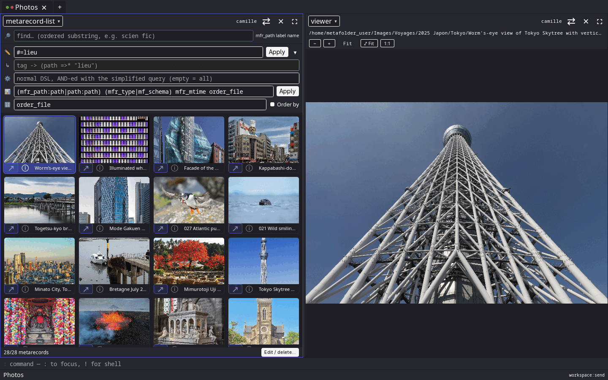
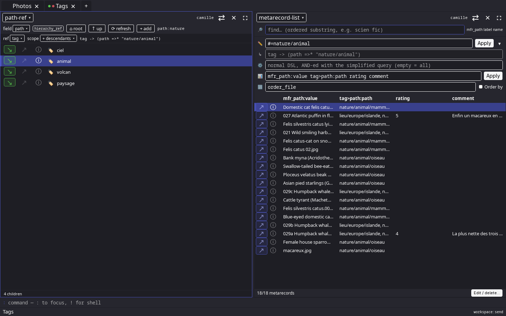
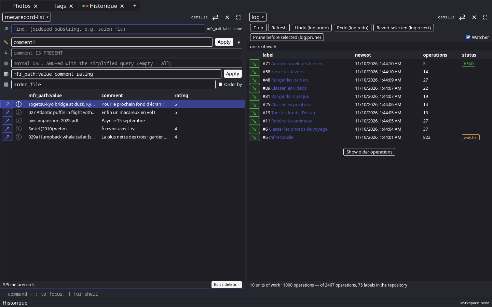

<!-- Generated from docs/wiki/tiddlers/readme.tid by scripts/dev/doc build: edit the note, not this file. -->

# metafolder

metafolder attaches metadata (tags, ratings, notes, any field of your own) to your
files without touching them, and lets you query it. It is local: a daemon holds your
repositories, each with its `.metafolder/` directory at its root, as `.git/` does, and
`mf`, the command line, and a desktop GUI talk to it. A file keeps its metadata when it is
moved or renamed, and every change can be undone.

**Status: version 0.3, early.** The HTTP API, the commands and the configuration keys
still change between versions without notice. What you have stored is kept: a change to
an on-disk format comes with its conversion ([Persisted format changes](docs/wiki/tiddlers/persisted-format-changes.tid)). This project
has been built predominantly with [Claude Code](https://claude.com/claude-code).

## What it looks like

The photos of three trips, found by their tag, as thumbnails beside a preview:



The tag hierarchy, and the files tagged with an animal of any kind, with their ratings and comments:



Every change is kept in the log, step by step, and any step can be undone:



The files shown are free (photographs mostly under CC BY-SA, so are these screenshots); their authors and licences are listed in `docs/wiki/images/CREDITS.md`.

## Installing

```
make check-deps        # what is missing, and the pacman line to install it (Arch Linux)
make install           # build in release, install into ~/.local/bin, install the configuration
make install-headless  # the same without the GUI and its toolkit (node is still needed)
```

To build for development instead: [Building](docs/wiki/tiddlers/building.tid).

## First steps

Start the daemon and leave it running, then from another terminal:

```
metafolder-daemon
```

```
mf repo init ~/music                                                # a repository, named "music"
mf -n music metarecord -q 'mfr_path = ""' field set mf_watch:bool=true   # follow its files
mf -n music reconcile                                               # bring in what is already there
mf -n music metarecord -q 'mfr_path = "/albums/one.flac"' field set rating:int=4
mf -n music metarecord -q 'rating > 3' get
mf -n music log                                                     # every change, which can be undone
```

The desktop interface is `metafolder-gui`, with the daemon running.
[Getting started](docs/wiki/tiddlers/getting-started.tid) explains all of this and goes further.

## Documentation

The documentation is a wiki, read in the GUI's help panel (`h h`), or from a checkout with
`scripts/dev/doc show Documentation`. Its notes are the files of `docs/wiki/tiddlers/`,
starting from [Documentation](docs/wiki/tiddlers/documentation.tid). To work on the project: [Development](docs/wiki/tiddlers/development.tid).
